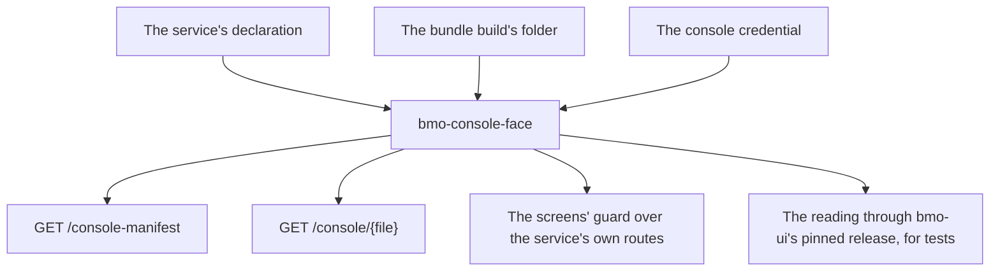

# The console face

A service that brings a console screen serves a console face: its manifest, its bundle's files and the guard
around them, as bmo-ui's `docs/console-bundles.md` states them. That document is the contract's one statement;
this one states only what the `bmo-console-face` crate takes from a service, what it fills in itself and what it
answers, and points to the contract for every rule it keeps.

## What a service supplies

- **One declaration**, a JSON object holding every manifest field the service decides: everything the
  contract's manifest names but `layer`, `bundle`, `stylesheet` and `words`. A declaration that names one of
  those four is refused, since the crate fills them.
- **The bundle build's folder**, as bmo-ui's bundle build writes it: the module, the stylesheet where the bundle
  has one, the chunks and other files the module loads, `layer.json`, and the words file. The service names
  the module's, the stylesheet's and the words' file names; every other file of the folder is a file the module
  loads, and is answered under the name the build gave it. A hidden entry, which a build keeps for itself, is
  not answered.
- **The console credential,** the token the console calls the service with, as a value. Where the service
  keeps it is the service's own.
- **Its own routes,** merged beside the face's, and the screens' guard laid over the ones the screens call.

## What the crate fills in

- **`layer`** is read from `layer.json` in the folder, as the bundle build wrote it, never from the declaration.
- **`bundle`, `stylesheet` and `words`** are paths under `/console/` made from each file's bytes, in the folder
  the file stands in: the file's kind, a dash, the first sixteen hexadecimal digits of the bytes' sha256, and
  the file's own extension. A file
  whose bytes change answers at a new path, so a console and a browser may keep what they loaded.
- **The chunks** keep the names the build gave them, under `/console/` at the same folder depth, since the module
  imports them by those names. The build names them by their bytes, as Vite does by default.

## Refused at start

Building the face reads the folder and the declaration, assembles the manifest and holds it to the contract's
JSON Schema, which bmo-ui's pinned release answers and which the crate carries as a generated file. Any of these
refuses the face, naming what is at fault, so a service whose manifest breaks the contract never answers one:

- a file the service named, or `layer.json`, that cannot be read, or words that are not one JSON object;
- a declaration that is not a JSON object, or that names a field the crate fills;
- two of the bundle's files that would answer at one path;
- a manifest the schema refuses, each field at fault named.

The schema carries every field's shape. The rules the contract's reading checks across fields (a title under the
bundle's namespace, the paths under the API prefix, no name twice, former screen paths that do not overlap) are
held by the reading through bmo-ui's release below.

## What it answers

| Route | Answers | Takes |
|---|---|---|
| `GET /console-manifest` | the manifest, whole | the console credential |
| `GET /console/{file}`, the words | the words file | the console credential |
| `GET /console/{file}`, the module, the stylesheet and every other file | the file's bytes | the console credential, and the manifest's role and owner key unless the manifest names a share read |

- **The console credential alone.** Each route takes `Authorization: Bearer` with the console credential. Any
  other token, the service's own among them, is refused 401 `unauthorized`, as is a call with none.
- **The role and the owner key.** The module, the stylesheet and every file beside them are refused 403
  `forbidden` where `Owner-Role` is missing or does not allow the manifest's role, or where the manifest asks
  for the owner key and `Owner-Key` is missing. A manifest that names a share read has them answered with
  neither, as the contract's 「Share pages」 states. The manifest and the words never ask for either.
- **A file that is not there** is answered 404 `not-found`, once the call has passed the guard.
- **Every refusal** is the common wire format's error body, `code` and `error`.
- **Caching.** A file under `/console/` is answered as kept for good, since its path follows its bytes; the
  manifest is answered to be asked again.

## The screens' guard

The crate lays a guard over the routes a service names as its screens' ones. A call that carries the console
credential is held to the manifest's role and owner key, refused 403 `forbidden` as the files are; any other call
passes to the service's own guard untouched, so a route the service's other callers reach stays theirs on their
own terms (the contract's 「Roles and the owner key」). The guard decides nothing about a call without the
console credential: the service's own guard refuses what it must.

A share read and the share head's read, a `GET` or a `HEAD` whose path a pattern under `shareReads` or
`shareHead` matches, pass on with no role and no owner key, since the contract holds them to their token: the
service answers each for a live token alone. A path matches a pattern as the contract's reading matches a share
read, in any letter case of the method; the crate's tests hold this matching to bmo-ui's own `shareRead`.

## The words

The face keeps the words it answers, and a service reads a word from them by its locale and its dotted key, so a
route of its own, a share head among them, speaks in the bundle's words without a second copy.

## The reading through bmo-ui's release

- **What it is.** The crate reads a manifest through bmo-ui's own `consoleManifest`, run by Bun from bmo-ui's
  packed release file, and answers the manifest as a console reads it, or the reading's refusal. It answers the
  contract's JSON Schema the same way, whether each of a list of method and path pairs is a share read of a
  manifest, as bmo-ui's `shareRead` answers it, and the contract's own terms: the manifest's route, the two
  headers and which role allows which. A service's running code never calls it.
- **What it needs.** Bun on the machine and the release file. It unpacks the file into a scratch folder of its
  own, which it removes after, and needs nothing of the release installed; Bun brings the one package the
  reading imports. It unpacks with the system's `tar`.
- **Who uses it.** The crate's own tests read the manifest it serves through it. A service using the face reads
  the manifest its own face serves through it in a test of its own, handing it the release file it vendors, so
  its test holds its own declaration to the whole reading.
- **What the crate restates is held to it.** The crate's tests hold its route, its header names, its order of
  the roles and its matching of share reads to what bmo-ui's release answers, so the crate keeps the contract by
  bmo-ui's own module and keeps no rule of its own.
- **The schema file.** The crate's tests fail where the schema it carries differs from the one bmo-ui's pinned
  release answers. `BMO_CONSOLE_FACE_WRITE_SCHEMA=1 cargo test -p bmo-console-face --test main schema::`
  writes it again from that release.

## The release it reads

The crate's own tests read bmo-ui's release that `shared-versions.toml` pins (`conventions.md`, 「Shared
versions」), from bmo-ui's `releases/` in the bmo-ui checkout beside this repository's, and hold the file to the
pinned sha256 first.
