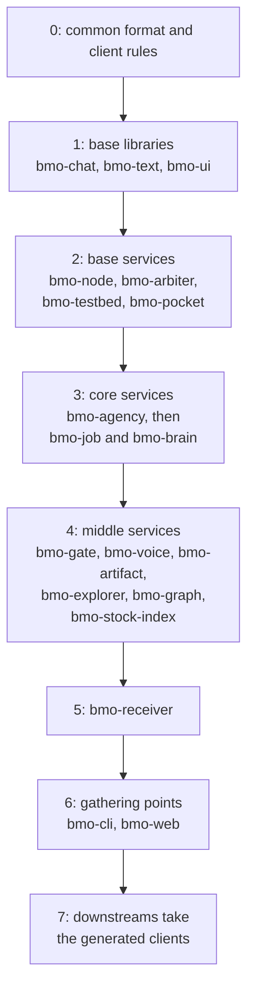

# bmo-next conventions

This document is the one source of two things every bmo-next repository follows: the common wire format a
service answers in, and the rules between an upstream and its downstreams. A service's own documents state its
routes and the pieces they carry, and take the format from here rather than restating it.

## Upstream and downstream

An **upstream** is a repository whose API another calls or imports; that other is its **downstream**. A
repository is often both: the receiver is downstream of the chat protocol and the agency, and upstream of the
chat services that call it.

### Generic and specific

- **Generic**: a capability several downstreams use, or a general one anyone would.
- **Specific**: one downstream's own circumstance, such as its name in a list of callers, or a path or field
  only it uses.

### Rules

- **An upstream stays generic.** Nothing specific goes into it.
- **A specific need is reshaped or kept downstream.** Where a general form of it exists, that form goes into the
  upstream; where none does, the downstream meets it with the API the upstream already serves.
- **An upstream's API is fixed once, before its downstreams are connected to it.** No connection gets an API of
  its own, so the same work is never served differently to different callers.
- **An upstream never knows its callers.** It supplies the mechanism and a safe default; the caller supplies
  the policy. No route, field, branch or list in it names a caller.
- **A change a downstream needs in an upstream is written as the general case.** It carries no name of the
  repository asking, no provider or unit name, no branch for one unit, and no data or test fixture only the
  asker uses; it comes with the upstream's own tests.
- **A downstream keeps no copy of what an upstream serves.** It waits on the upstream for the missing part and
  carries on with the rest, then pins the upstream version that serves it.
- **A downstream document points at the upstream's document** for what the upstream serves, rather than
  restating it.

## The common wire format

Every service answers in this one format, to every caller. A service never answers each caller in that
caller's own format.

| Concern | Convention |
|---|---|
| Keys | Field names in camelCase. |
| Times | One integer of epoch milliseconds. |
| Identifiers | Rooms, messages, senders, items and rows are signed 64-bit integers. |
| Runs | A run's ledger id (a number) and its run name (the unit name, a string) are carried in two fields of different names, both present. |
| Errors and refusals | A non-2xx status with a body of two keys, `code` and `error`. A refusal is answered by status too. |
| Error codes | kebab-case, in step with the camelCase keys. |
| Lists | One cursor, `before` or `after` (an id or a time), and `limit`. |

### Why these

- **camelCase** is what the chat protocol uses, and every service stands on it. Callers move to generated
  clients, so the cost of a change of keys falls once, on the serving side.
- **Milliseconds** keep the order of events within one second, and leave no conversion between seconds and
  milliseconds for a caller to get wrong.
- **One error shape** means a caller reads every failure the same way. A 2xx carrying a flag such as `answered:
  false`, a `problem+json` body, or a `code` with a `text` key are each a second shape, and are not used.

## API design

Every service's HTTP API is shaped by these rules, so a caller who has read one service reads every other the
same way. The wire format above says how a value is written; this section says how routes and bodies are laid
out.

### Resources

- **One resource lives in one service.** Every other service reads it through that service's client, and keeps
  no copy of it, no route that serves it again under another name, and no route that relays it.
- **One noun names one thing across every service.** Two things that are not the same never share a noun: a
  test run is a `test-run`, and a `run` is an agent's run wherever the word appears.
- **What a service holds about another service's resource is its own resource,** found by the reference
  (`GET /judgements?roomId=`), or keyed by it where the service holds one such member for each
  (`/session-loads/{sessionId}`). One such resource every holder of per-room data shares: each serves
  `GET /room-holdings/{roomId}` for what it holds of a room and `DELETE /room-holdings/{roomId}` to let it go,
  the second answering a preview with `dryRun=true`.

### Paths

- **A path names resources, never an action.** A collection is its plural noun in kebab-case (`/rooms`,
  `/log-lines`), and one member is the collection followed by its key (`/rooms/{roomId}`). A mass noun stands as
  it is (`/usage`, `/health`), and a resource the service holds exactly one of is named in the singular
  (`/owner`, `/settings`, `/declaration`).
- **A key is the member's id,** a signed 64-bit integer, or its name where a person names it: an agent, a
  worker, a gate, a provider, a node. A path parameter says which: `{roomId}`, `{agentName}`.
- **Nesting is one level, under the owner,** and only for a member that cannot exist without that owner
  (`/rooms/{roomId}/messages/{messageId}`). A member's own parts nest under it, and their content under them
  (a message's files, and each file's bytes).
  Anything addressed on its own is a top-level collection, filtered by query (`/runs?agentName=`).
- **A query is camelCase, filters or pages a list, and never changes anything.** Several members are read by
  one GET with `ids=` and a comma-separated list, never by a POST.
- **No prefix and no version in a path.** A console or gateway that serves a service to a browser mounts it
  under `/api/<service>/` and passes the path on unchanged.

### Methods

| Method | On | Does | Answers |
|---|---|---|---|
| `GET` | a collection | lists it | 200, a page |
| `GET` | a member | reads it | 200, the member |
| `POST` | a collection | creates a member | 201, the member |
| `PUT` | a member | creates or replaces a member whose key the caller names | 201 or 200, the member |
| `PATCH` | a member | changes the fields the body names, as a JSON merge patch | 200, the member |
| `DELETE` | a member | removes it | 204 |

- **GET and DELETE carry no body, and GET changes nothing.**
- **A route that answers bytes** (a picture, a sound, an attachment) is a member's `content`, a part of its own
  (`/briefings/{briefingId}/sound`), and honours `Range` where the bytes are long.

### Actions

An action is one of three shapes, chosen in this order:

1. **A change of state** is a PATCH of the field it changes, most often `state`
   (`PATCH /runs/{runId}` with `{"state": "stopped"}`). The member's states and the moves allowed between them
   are listed in the service's document; a move not allowed is answered 409 `conflict`.
2. **An action that leaves a record** is a POST creating that record in a collection named for it
   (`POST /sessions/{sessionId}/turns`, `POST /judgements`).
3. **A computation that keeps nothing** (a reading, a check, a rendering) is a POST to a collection named for
   its result, answered 200 with the result and keeping no member (`POST /dialect/readings`). Its name is the
   noun of what comes back.

A preview of any of them is the same request with `dryRun=true`, answered with what would happen.

### Bodies

- **A member has one shape** wherever it is answered: alone, in a list, inside an event.
- **A page is `{"items": [...], "more": boolean}`.** `more` says whether anything stands past the last item; the
  next page is asked with that item's key or time as the cursor the wire format names.
- **Names say what a field holds.** A member's own key is `id`; a reference is `<role>Id` (`roomId`, `senderId`,
  `runId`) or `<role>Name` for a named resource (`agentName`). An instant ends in `At`, a span in `Ms`, a count
  in `Count`, and a boolean reads as a statement (`pinned`, `live`). A discriminator is `kind`, and a member's
  place in its life is `state`.
- **A field keeps its name in every service.** A room is `roomId` everywhere, never `chat`, `chatId` or
  `chat_id`.

### Errors

Every route answers its failures in the wire format's error shape, with these codes beside its own:

| Status | `code` | When |
|---|---|---|
| 400 | `bad-request` | the body or the query is not the shape the route takes; the sentence names what is wrong |
| 401 | `unauthorized` | the token is missing or wrong |
| 403 | `forbidden` | the token is right but the caller may not do this |
| 404 | `no-route` | no route answers this method and path |
| 404 | `not-found` | the route is right, but nothing stands at the key the path names |
| 409 | `conflict` | the member's state does not allow the change, or the key is taken |
| 410 | `gone` | the member stood once and never will again, so the caller lets go of it |
| 413 | `too-large` | the body or a file is over the route's ceiling |
| 422 | a code of the route's own | the request is well formed but a rule of the service refuses it; the code names the rule |
| 500 | `failed` | the service failed; the sentence is the failure |
| 502 | `upstream-failed` | a service this one called failed; the sentence names it |
| 503 | `not-ready` | the service is up but cannot answer yet; `Retry-After` says when to ask again |

A code means one thing in every service. Each route's document and OpenAPI entry list the codes it can answer.

### Events and streams

- **A service with events serves one stream, `GET /events`,** as server-sent events. No other route streams
  events: a screen that shows a resource live reads the collection once, then the stream.
- **An event names a resource and its change:** its SSE `event` is `<resource>.<change>`, the singular noun and
  one of `created`, `changed`, `deleted` or a state the resource moved to (`message.created`,
  `run.stopped`). Its `id` is the service's event number, a signed 64-bit integer that only grows. Its `data`
  is `{"id", "kind", "at", "data"}`, the inner `data` being the member as a GET answers it, or its key alone for
  `deleted`.
- **A reader resumes** with `Last-Event-ID` or `after`, and narrows with `kinds` (a comma-separated list) and
  with the key of the resource events belong to (`roomId`). The service keeps a window of past events, stated
  in its document; a resume from before the window is answered 410 `gone`, and the reader reads the
  collections again.
- **The same events are a page** to a reader asking `Accept: application/json`, by `after` and `limit`, for a
  caller that polls.
- **A comment line every fifteen seconds** keeps the stream open; a reader that hears nothing for a minute
  reconnects.
- **A service publishes only its own events.** No service takes another's events in to serve them again: a
  reader reads each service's stream. A process of the service's own posts an event with `POST /events`.
- **An upstream that needs an answer from a downstream at a point of its work calls a hook.** The downstream
  registers it in the upstream's `/hooks` collection (`point`, `url`), and serves it at `POST /hooks/{point}`;
  the upstream's OpenAPI document states each point's body and answer under `webhooks`. The upstream names no
  downstream: what it calls is what was registered.
- **A byte stream** is a member's content route. A WebSocket is used only where both sides speak in one
  connection, as a terminal does.

### Health, commands and tools

- **Every service serves `GET /health`,** answering `ready`, `reason` (null when ready) and `version`. Like
  every route, it takes the token.
- **A command reads and changes resources through the service's own client,** and with `--json` prints the
  member or the page exactly as the API answers it.
- **A tool's input and output are JSON Schemas** in the service's OpenAPI document, under `x-tools`, written in
  this wire format.

### The OpenAPI document

- **The OpenAPI 3.1 document is the contract,** committed as the service's `docs/openapi.json`. It is generated
  from the service's own types, and a test fails where the committed document differs from what the code
  generates. The Rust crate and the TypeScript package a service publishes are generated from it.
- **The document's version is the service's,** in semver. A removed or renamed route or field, or a field that
  becomes required, is a major version.

## Service documents

- **Sections by resource.** A service's document groups its routes by the resource they act on, never by the
  caller that uses them. No section is written for one caller.
- **No caller names.** A document names no caller, and a service keeps no list of callers that a new caller
  would have to be added to.

## Clients

- **A service supplies its own client.** It keeps one OpenAPI document in its repository, and from that one
  document it publishes a Rust crate and a TypeScript package.
- **A client carries the service's contract and nothing else.** No caller's policy goes into it.
- **A caller uses the published client.** It writes no client of its own by hand.

## The order upstreams are fixed in

An upstream's API is fixed before the layer below takes it, and each layer takes what the one above fixed in
one step. The common format comes first, since fixing an API before the format would mean changing it again.

- **Layer 1.** bmo-chat defines, as protocol, the routes a provider calls on the receiver, and is the first to
  carry times in milliseconds.
- **Layer 3.** bmo-agency comes before bmo-job and bmo-brain, which call it.
- **Layer 4.** Its services do not overlap and are fixed side by side.
- **Layer 5.** bmo-receiver is upstream of the chat services and downstream of the agency, brain, voice, gate
  and chat, so it is fixed once those are.
- **Layer 6.** bmo-cli and bmo-web gather every unit, so they come last among upstreams. bmo-web attaches every
  bundle through one plugin contract rather than code of its own per bundle.
- **Layer 7.** Each downstream replaces its hand-written clients with the generated ones, moves its copies of
  base code into the base, and meets in itself the specific needs that were kept out of its upstreams.

## A service whose API differs

- A service's own document states the API it serves now, and its callers rely on that document.
- Where that API's wire or design differs from this document, the service is brought into line when its API is
  fixed, in the order above, and its document is repaired with it.
