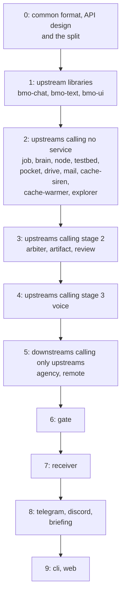

# bmo conventions

This document is the one source of three things every bmo repository follows: the common wire format a
service answers in, the rules between an upstream and its downstreams, and how a Rust unit builds, lays out
its tests and takes its shared registry crates and the one release of bmo-ui. A service's own documents state
its routes and the pieces they carry, and take the format from here rather than restating it.

## Upstream and downstream

Units are split by independence. An **upstream** is a unit a coding harness (Claude Code, Codex, a DeepSeek
harness and the like) can take as its first entry point with no web console: offered to the harness as an MCP
server, or imported by what the harness builds, it is of use with no other BMO unit running. A
**downstream** is a unit that depends on BMO: its first entry point is BMO itself, a person talking to BMO's
agents, BMO's console or BMO's chat platforms.

This split is neither repository independence, which every repository keeps on its own, nor the rule that an
upstream carries no context of its downstreams; both hold beside it. The test for a unit whose side is in doubt
is whether it can be offered to a harness as an MCP server and be of use there: if it can, it is upstream.

### The units

| Side | Units |
|---|---|
| Upstream libraries | bmo-chat (the chat protocol and the console face), bmo-text, bmo-ui |
| Upstream services | bmo-job (todo), bmo-brain, bmo-pocket, bmo-node, bmo-arbiter, bmo-testbed, bmo-cache-siren, bmo-cache-warmer, bmo-explorer, bmo-review, bmo-voice (the speech engine), bmo-drive, bmo-mail, bmo-artifact (keeping, search and share links) |
| Downstream services | bmo-agency (one service), bmo-receiver, bmo-gate, bmo-briefing (the voice briefings), bmo-telegram, bmo-discord, bmo-remote, bmo-cli, bmo-web |
| Downstream content | bmo-persona |
| Skills | a unit's harness plugin carries the `bmo-<unit>` skill, its product name |

The units whose side needs a reason:

- **The chat providers are downstream and the chat protocol upstream.** A provider's first entry point is a
  person on its platform, and everything it takes in goes to the receiver. The protocol is a library any
  chat service implements, and its MCP server drives any provider at a given address.
- **bmo-voice is the speech engine; the briefings are bmo-briefing.** Speaking, transcribing and the voices
  are of use to any harness. A briefing is spoken into one of BMO's rooms by one of BMO's agents.
- **bmo-artifact is upstream as keeping, search and share links.** A research run and a spoken narration are
  agent work, so they are downstream's: each is an agency session that files what it makes through
  bmo-artifact's MCP server.
- **bmo-review is upstream as the work it computes**: a review of a checkout. Choosing the agent and the room,
  and sending the result, are downstream's; a unit of the owner's own that computes work for an agent stands on
  the same side.
- **bmo-remote is downstream.** It relays a terminal and a desktop to a console screen; a harness already
  has a shell, so offered as an MCP server it adds nothing.
- **bmo-gate is downstream.** Its gates judge the turns of BMO's agents.

### What an upstream is

- **Its API knows nothing of BMO.** No route, field, parameter or tool names an agent, a worker, a room, the
  owner, a persona, a companion, the receiver, an agent's session or run, a worker's job, the console, or
  anything only BMO uses. The chat protocol's rooms, messages, people and account owner are the chat
  domain's own nouns and stay in it.
- **It groups and attributes by the caller's opaque strings,** the same names in every upstream: `scope`
  for what a member is held under (BMO writes its own, such as a room or an agent, and the upstream never
  reads them), `<role>Name` for who made or holds a member (`actorName`, `holderName`, `assigneeName`), and
  `labels` for the caller's own metadata.
- **It publishes its client and its harness plugin.** The plugin is an MCP server the unit's own binary
  starts (`bmo-<unit> mcp`) and a `bmo-<unit>` skill that tells a harness when and how to use it. Each
  tool is a thin call of one route, one library function or one of its commands, through the unit's own
  client.
- **A unit that keeps state is middleware,** in the way Redis is one: it stores members, serves them through
  its API and publishes its own events, and never executes. It launches no run, opens no agent session,
  sends nothing to a room and calls no unit: the only calls it makes are deliveries to the addresses its
  subscribers registered. What happens at a time is an event a client acts on (`reminder.due`,
  `watch.fired`, `lease.expired`). Work reaches whoever does it two ways, side by side: pushed, as the
  events of a subscription the one doing it registered, and pulled, by a lease. `POST /leases` takes the next
  member of a queue, or the member it names, for a holder for a span, `PATCH` renews it, `DELETE` gives it
  back, and a lease that runs out gives its member back. bmo-job and bmo-brain are middleware.
- **It calls only upstreams,** by their clients, and imports no downstream's crate or package.

### What a downstream is

- **It holds every BMO concept:** agents, workers, rooms, the owner, personas, agent sessions and runs, jobs as
  runs of items, briefings and talks.
- **It consumes an upstream only through that upstream's client,** or its MCP server for an agent, and keeps
  no copy of what the upstream serves. What it wrote into an upstream under its own scopes it lets go of
  itself, when the room or agent behind them goes.
- **It calls upstreams and earlier downstreams,** in the order below, and no later one.
- **It exposes only its own nouns, never a forwarding route.** Every route and tool of a downstream serves a
  resource that downstream holds. None only forwards to a unit its caller can reach directly, or only strings
  together calls of such units: the caller, whether a harness, an agent's session or another downstream, calls
  that unit itself through its client or its MCP server. A gateway to units its caller cannot reach on its own,
  as the console relays a browser to the services behind it, does not forward in this sense.

### A harness, its work and what runs it

Work kept in middleware is done by a harness, and the harness is the only one that calls both the middleware
keeping the work and whatever runs it. For an item of bmo-job:

- **The job service tells a harness of work, and a harness takes work from it.** The two ways stand side by
  side. Push: the harness registers a subscription on the queues it serves, and each item opened there, or
  each other change it asked for, reaches it as a webhook to its URL or, through `bmo-job mcp`, as an MCP
  notification in its session. Pull: the harness takes an item with a lease, whether a push woke it or it
  asked on its own. A push hands nothing over: harnesses told of one item race for its lease, and the one
  that loses is answered 409.
- **With no agency, the harness runs the item itself,** in its own session and environment: it reads the
  brief, notes and work order, reports and closes the item. This is the base case, and it needs no unit
  but bmo-job, which is why bmo-job is upstream.
- **With an agency, the harness holding the item calls the agency.** It asks for a worker to be assigned,
  then hands the agency the item's content and its lease to run on that worker. The run's progress, its
  questions and its outcome come back to the harness from the agency; the harness renews the lease while
  the run lasts, passes words appended to the item into the run, and reports and closes in the job service
  itself.
- **The job service and the agency never call each other.** Neither imports the other's client or
  registers anything in the other; each answers only the harness that called it, and neither knows which
  harness that is.
- **In BMO's own setup the harness is the chat agent's session or the runner.** The chat agent's harness
  carries the bmo-job plugin beside the agency's agent tools and decides on each item it is told of; the
  agency puts the plugin in that session's launch line and calls nothing of the job service itself. The
  runner, a command of bmo-cli kept running as a unit, holds the subscriptions of the queues that progress
  on their own and takes the same steps by each queue's policy. Both are downstream: no upstream route or
  field names either.
- **A run with a fixed prompt is an ordinary session.** A digest, a research, a browse, a narration or the
  morning news is an agency session started with `POST /sessions`, naming the run's prompt document and
  carrying its bounds in the session's options. Whoever wants the run starts it, the runner on its schedule
  among them, and the session calls the upstreams it needs through their MCP servers. The agency keeps no route
  or tool for any such run. A limit on one belongs to the session's options, to the co-worker pool for how
  many run at once, or to the upstream that owns the resource, as a search engine's cooldown is bmo-explorer's.

### Generic and specific

- **Generic**: a capability several downstreams use, or a general one anyone would.
- **Specific**: one downstream's own circumstance, such as its name in a list of callers, or a path or field
  only it uses.

### Rules

These rules hold between every unit and the units it calls: between two downstreams, the one called stands
as the upstream for them.

- **An upstream stays generic.** Nothing specific goes into it.
- **A specific need is reshaped or kept downstream.** Where a general form of it exists, that form goes into the
  upstream; where none does, the downstream meets it with the API the upstream already serves.
- **An upstream's API is fixed once, before its downstreams are connected to it.** No connection gets an API of
  its own, so the same work is never served differently to different callers.
- **An upstream never knows its callers.** It supplies the mechanism and a safe default; the caller supplies
  the policy. No route, field, branch or list in it names a caller.
- **A change a downstream needs in an upstream is written as the general case.** It carries no name of the
  repository asking, no provider or unit name, no branch for one unit, and no data or test fixture only the
  asker uses; it comes with the upstream's own tests.
- **A downstream keeps no copy of what an upstream serves.** It waits on the upstream for the missing part and
  carries on with the rest, then pins the upstream version that serves it.
- **A downstream document points at the upstream's document** for what the upstream serves, rather than
  restating it.

## The common wire format

Every service answers in this one format, to every caller. A service never answers each caller in that
caller's own format.

| Concern | Convention |
|---|---|
| Keys | Field names in camelCase. |
| Times | One integer of epoch milliseconds. |
| Identifiers | Rooms, messages, senders, items and rows are signed 64-bit integers. |
| Runs | A run's ledger id (a number) and its run name (the unit name, a string) are carried in two fields of different names, both present. |
| Errors and refusals | A non-2xx status with a body of two keys, `code` and `error`. A refusal is answered by status too. |
| Error codes | kebab-case, in step with the camelCase keys. |
| Lists | One cursor, `before` or `after` (an id or a time), and `limit`. |

### Why these

- **camelCase** is what the chat protocol uses, and every service stands on it. Callers move to generated
  clients, so the cost of a change of keys falls once, on the serving side.
- **Milliseconds** keep the order of events within one second, and leave no conversion between seconds and
  milliseconds for a caller to get wrong.
- **One error shape** means a caller reads every failure the same way. A 2xx carrying a flag such as `answered:
  false`, a `problem+json` body, or a `code` with a `text` key are each a second shape, and are not used.

## API design

Every service's HTTP API is shaped by these rules, so a caller who has read one service reads every other the
same way. The wire format above says how a value is written; this section says how routes and bodies are laid
out.

### Resources

- **One resource lives in one service.** Every other service reads it through that service's client, and keeps
  no copy of it, no route that serves it again under another name, and no route that relays it.
- **One noun names one thing across every service.** Two things that are not the same never share a noun: a
  test run is a `test-run`, and a `run` is an agent's run wherever the word appears.
- **What a service holds about another service's resource is its own resource,** found by the reference
  (`GET /judgements?roomId=`), or keyed by it where the service holds one such member for each
  (`/session-loads/{sessionId}`).
- **What a service holds under a key it does not own has one shape.** An upstream serves
  `GET /scopes/{scope}` for what it holds under a caller's scope and `DELETE /scopes/{scope}` to let it go. A
  downstream that holds data of BMO's rooms serves `GET /room-holdings/{roomId}` and
  `DELETE /room-holdings/{roomId}` the same way, and lets go of the scopes it wrote into upstreams for that
  room. Each `DELETE` answers a preview with `dryRun=true`.

### Paths

- **A path names resources, never an action.** A collection is its plural noun in kebab-case (`/rooms`,
  `/log-lines`), and one member is the collection followed by its key (`/rooms/{roomId}`). A mass noun stands as
  it is (`/usage`, `/health`), and a resource the service holds exactly one of is named in the singular
  (`/owner`, `/settings`, `/declaration`).
- **A key is the member's id,** a signed 64-bit integer, or its name where a person names it: an agent, a
  worker, a gate, a provider, a node. A path parameter says which: `{roomId}`, `{agentName}`.
- **Nesting is one level, under the owner,** and only for a member that cannot exist without that owner
  (`/rooms/{roomId}/messages/{messageId}`). A member's own parts nest under it, and their content under them
  (a message's files, and each file's bytes).
  Anything addressed on its own is a top-level collection, filtered by query (`/runs?agentName=`).
- **A query is camelCase, filters or pages a list, and never changes anything.** Several members are read by
  one GET with `ids=` and a comma-separated list, never by a POST.
- **No prefix and no version in a path.** A console or gateway that serves a service to a browser mounts it
  under `/api/<service>/` and passes the path on unchanged.

### Methods

| Method | On | Does | Answers |
|---|---|---|---|
| `GET` | a collection | lists it | 200, a page |
| `GET` | a member | reads it | 200, the member |
| `POST` | a collection | creates a member | 201, the member |
| `PUT` | a member | creates or replaces a member whose key the caller names | 201 or 200, the member |
| `PATCH` | a member | changes the fields the body names, as a JSON merge patch | 200, the member |
| `DELETE` | a member | removes it | 204 |

- **GET and DELETE carry no body, and GET changes nothing.**
- **A route that answers bytes** (a picture, a sound, an attachment) is a member's `content`, a part of its own
  (`/briefings/{briefingId}/sound`), and honours `Range` where the bytes are long.

### Actions

An action is one of three shapes, chosen in this order:

1. **A change of state** is a PATCH of the field it changes, most often `state`
   (`PATCH /runs/{runId}` with `{"state": "stopped"}`). The member's states and the moves allowed between them
   are listed in the service's document; a move not allowed is answered 409 `conflict`.
2. **An action that leaves a record** is a POST creating that record in a collection named for it
   (`POST /sessions/{sessionId}/turns`, `POST /judgements`).
3. **A computation that keeps nothing** (a reading, a check, a rendering) is a POST to a collection named for
   its result, answered 200 with the result and keeping no member (`POST /dialect/readings`). Its name is the
   noun of what comes back.

A preview of any of them is the same request with `dryRun=true`, answered with what would happen.

### Bodies

- **A member has one shape** wherever it is answered: alone, in a list, inside an event.
- **A page is `{"items": [...], "more": boolean}`.** `more` says whether anything stands past the last item; the
  next page is asked with that item's key or time as the cursor the wire format names.
- **Names say what a field holds.** A member's own key is `id`; a reference is `<role>Id` (`roomId`, `senderId`,
  `runId`) or `<role>Name` for a named resource (`agentName`). An instant ends in `At`, a span in `Ms`, a count
  in `Count`, and a boolean reads as a statement (`pinned`, `live`). A discriminator is `kind`, and a member's
  place in its life is `state`.
- **A field keeps its name in every service.** A room is `roomId` everywhere, never `chat`, `chatId` or
  `chat_id`.

### Errors

Every route answers its failures in the wire format's error shape, with these codes beside its own:

| Status | `code` | When |
|---|---|---|
| 400 | `bad-request` | the body or the query is not the shape the route takes; the sentence names what is wrong |
| 401 | `unauthorized` | the token is missing or wrong |
| 403 | `forbidden` | the token is right but the caller may not do this |
| 404 | `no-route` | no route answers this method and path |
| 404 | `not-found` | the route is right, but nothing stands at the key the path names |
| 409 | `conflict` | the member's state does not allow the change, or the key is taken |
| 410 | `gone` | the member stood once and never will again, so the caller lets go of it |
| 413 | `too-large` | the body or a file is over the route's ceiling |
| 422 | a code of the route's own | the request is well formed but a rule of the service refuses it; the code names the rule |
| 500 | `failed` | the service failed; the sentence is the failure |
| 502 | `upstream-failed` | a service this one called failed; the sentence names it |
| 503 | `not-ready` | the service is up but cannot answer yet; `Retry-After` says when to ask again |

A code means one thing in every service. Each route's document and OpenAPI entry list the codes it can answer.

### Events and streams

- **A service with events serves one stream, `GET /events`,** as server-sent events. No other route streams
  events: a screen that shows a resource live reads the collection once, then the stream.
- **An event names a resource and its change:** its SSE `event` is `<resource>.<change>`, the singular noun and
  one of `created`, `changed`, `deleted` or a state the resource moved to (`message.created`,
  `run.stopped`). Its `id` is the service's event number, a signed 64-bit integer that only grows. Its `data`
  is `{"id", "kind", "at", "data"}`, the inner `data` being the member as a GET answers it, or its key alone for
  `deleted`.
- **A reader resumes** with `Last-Event-ID` or `after`, and narrows with `kinds` (a comma-separated list) and
  with the key of the resource events belong to (`roomId`). The service keeps a window of past events, stated
  in its document; a resume from before the window is answered 410 `gone`, and the reader reads the
  collections again.
- **The same events are a page** to a reader asking `Accept: application/json`, by `after` and `limit`, for a
  caller that polls.
- **A comment line every fifteen seconds** keeps the stream open; a reader that hears nothing for a minute
  reconnects.
- **A service publishes only its own events.** No service takes another's events in to serve them again: a
  reader reads each service's stream. A process of the service's own posts an event with `POST /events`.
- **A service that needs an answer from its caller at a point of its work calls a hook.** The caller
  registers it in the service's `/hooks` collection (`point`, `url`), or with the member the hook is for, and
  serves it at `POST /hooks/{point}`; the service's OpenAPI document states each point's body and answer under
  `webhooks`. The service names no caller: what it calls is what was registered.
- **A service tells a caller of its changes through a subscription the caller registers.** `POST
  /subscriptions` names the subscriber (`holderName`), the event kinds and filters it wants (a queue, a
  scope, some members), a `url` for webhook delivery or none for the stream form, and a `ttlMs` that
  `PATCH` renews; a subscription that runs out goes. Each matching event is delivered in its stream shape,
  `{"id", "kind", "at", "data"}`: posted to the `url` as the webhook the OpenAPI document states under
  `webhooks`, at least once and in event order, and acknowledged by a 2xx; or, in the stream form, read on
  `GET /events` narrowed by `subscriptionId`. A unit's MCP server takes the stream form and turns each
  event into an MCP notification to its harness. A webhook that keeps failing moves the subscription to
  `failing`, and delivery starts again from the event it stopped at once the subscriber sets its `state`
  back. A hook asks the caller for an answer at a point of the work; a subscription tells the caller and
  waits for nothing.
- **Only a caller registers a hook or a subscription in what it calls,** so an upstream registers none in
  a downstream.
- **A byte stream** is a member's content route. A WebSocket is used only where both sides speak in one
  connection, as a terminal does.

### Health, commands and tools

- **Every service serves `GET /health`,** answering `ready`, `reason` (null when ready) and `version`. Like
  every route, it takes the token.
- **A command reads and changes resources through the service's own client,** and with `--json` prints the
  member or the page exactly as the API answers it.
- **A tool's input and output are JSON Schemas** in the service's OpenAPI document, under `x-tools`, written in
  this wire format. An upstream's `x-tools` are its MCP server's tools, named `<unit>_<what>` in snake_case,
  each naming the route, the library function or the command it calls; `x-harness` names its plugin, the
  command that starts its MCP server, what a harness does first with it, and the MCP notifications the
  server sends where the unit serves subscriptions.

### The OpenAPI document

- **The OpenAPI 3.1 document is the contract,** committed as the service's `docs/openapi.json`. It is generated
  from the service's own types, and a test fails where the committed document differs from what the code
  generates. The Rust crate and the TypeScript package a service publishes are generated from it. A library
  whose routes are served on two sides, as the chat protocol's are, commits one document for each side under
  `docs/openapi/`, since the two sides may serve paths of the same shape.
- **The document's version is the service's,** numbered as 「Versions」 states.

### Versions

- **The set has one version,** in semver, and every unit stands at it: every crate and package a unit
  publishes, its health, its OpenAPI document and its plugin answer it, beside the commit that runs. A unit
  added to the set takes the set's version; no unit counts a version of its own.
- **Five kinds of version, ordered by semver for the same `X.Y.Z`:**

  | Kind | Form | What it is |
  |---|---|---|
  | nightly | `X.Y.Z-0.nightly.<YYYYMMDD>`, `.<n>` from 2 for a second the same day | main as it stands that day; made daily, never declared |
  | alpha | `X.Y.Z-alpha.<N>` | a milestone on main; its features may be incomplete |
  | beta | `X.Y.Z-beta.<N>` | the feature freeze of `X.Y.Z` |
  | rc | `X.Y.Z-rc.<N>` | a candidate; only fixes follow it, and any change makes the next `N` |
  | stable | `X.Y.Z` | the release |

  So `1.1.0-0.nightly.20261124` < `1.1.0-alpha.1` < `1.1.0-beta.1` < `1.1.0-rc.1` < `1.1.0`: the leading `0`
  of a nightly's pre-release is numeric, and semver orders a numeric identifier before every alphanumeric
  one. `N` counts from 1 within its kind and its `X.Y.Z`.
- **A version moves only at a release, and a release is the owner's word for the whole set.** A commit, a
  deploy, a fix, a document change or a contract change moves no version by itself. When the owner declares an
  alpha, a beta, a release candidate, a stable release or a patch, every unit that declares a version takes it
  in one commit of its own that releases it, its documents' "Fixed at" line names that version, and each
  repository is tagged `v<version>` on that commit, or on the head it was cut from where it declares none, a
  unit with no change since the last release included. The release notes stand once, on the index
  repository's release, unit by unit, and the project's site lists them. Releases are cut by the set's
  maintainer; no unit of the set carries the means.
- **The next version follows semver over the whole set since the last stable release:** a removed or renamed
  route, field, verb or flag of any unit, or a field that becomes required, makes it a major release; a new
  route, field, verb, screen or setting a minor one; fixes alone a patch. The owner's word settles the step.
- **A release line has a branch of its own.** The first beta of `X.Y.0` cuts `release/X.Y` in every repository
  at its release commit, and main moves on towards the next minor. Every later beta, every release candidate,
  the stable release and every patch `X.Y.(Z+1)` is made on `release/X.Y`. A fix lands on main first and is
  then taken onto the release branch, never the other way round.
- **What each kind must pass before it is made:**
  - a nightly: each unit's check;
  - an alpha: what a nightly passes;
  - a beta: every unit's whole suite, its browser tests among it, and an install rehearsal of each of the
    three presets;
  - a release candidate: what a beta passes, no open blocker, an upgrade from the last stable release with
    every database migration it carries, signed desktop builds, and the documents, the site and the release
    notes done;
  - a stable release: the release candidate unchanged for three days, and the owner's approval;
  - a patch: what a release candidate passes.
- **A nightly names the next unreleased version,** the one main leads to: the minor above a stable release, as
  `1.1.0-0.nightly.20261124` after `1.0.0`; `X.Y.Z` itself while an alpha of `X.Y.Z` is main's last release; the
  minor above once a beta of `X.Y.Z` has cut its release branch, as `1.2.0-0.nightly.20261201` after
  `1.1.0-beta.1`; and `1.0.0` before the set's first release, as `1.0.0-0.nightly.20261124`. The day is the one
  it was made on in the platform's time zone, Asia/Seoul.
- **The deployed state between releases is the nightly.** A deployment of a commit no release tag names is
  named for the day's nightly, the day the deployment was laid. A nightly is a name the deployment computes,
  never written into a manifest and never tagged. Which change is live is still the commit, everywhere a person
  reads it.
- **Before the set's first release** a unit stands at `0.1.0` or one of its `0.1.0-rev.<n>` revisions, and its
  nightly is `1.0.0-0.nightly.<YYYYMMDD>`, above every version the set numbered before it. The first release is
  `1.0.0`, for every unit at once.
- **Where each kind runs.** The owner's own deployment runs the nightly track, and may be pinned to a beta or a
  release candidate. The desktop apps take their updates on one of three channels: `stable`, stable releases
  alone; `preview`, alphas, betas, release candidates and stable releases; and `nightly`, every kind. A
  self-hosted installation chooses its track when it is installed, stable unless it chooses otherwise.
- **A declaration's `testbed` number is its format's, not the set's version:** a unit's `testbed.toml` names
  the major of the declaration's schema, which moves only when that format breaks (bmo-testbed's
  `docs/declaration.md`).
- **A consumer never pins a sibling's version.** A dependency on another unit of the set is by path (a path
  dependency, a workspace member, a client package taken from its checkout), with no exact version
  requirement; the testbed builds each unit against the sibling checkouts and that build is the compatibility
  check. A client pack a consumer vendors is named by the commit it was packed from, not by a version.
- **bmo-ui is the one exception.** A bundle runs on its console's own copy of the layer, so a bundle stands on a
  pack inside the range its console's pack declares (bmo-ui's `docs/console-bundles.md`, 「The layer a bundle
  is built on」). bmo-ui packs at every set release under the set's version, and between releases as the day's
  nightly, `X.Y.Z-0.nightly.<YYYYMMDD>`, with `.<n>` from 2 for a second pack the same day. A pack named in the
  earlier nightly form, `X.Y.Z-nightly.<YYYYMMDD>[.<n>]`, is ordered as the same day's pack of the present
  form. Every consumer vendors a packed file bmo-ui's release verb wrote, for the pack `shared-versions.toml` pins
  or for one of the earlier packs it names compatible with it (「Shared versions」), never a pack of its own.
- **What a version says** is therefore which release or which day's nightly a running unit stands at; which
  change is live is the commit.

## Service documents

- **Sections by resource.** A service's document groups its routes by the resource they act on, never by the
  caller that uses them. No section is written for one caller.
- **No caller names.** A document names no caller, and a service keeps no list of callers that a new caller
  would have to be added to.

## Clients

- **A service supplies its own client.** It keeps one OpenAPI document in its repository, and from that one
  document it publishes a Rust crate and a TypeScript package.
- **An upstream supplies its harness plugin beside its client:** the MCP server its own binary starts and its
  `bmo-<unit>` skill, both in its repository, built on that client.
- **A client carries the service's contract and nothing else.** No caller's policy goes into it.
- **A caller uses the published client.** It writes no client of its own by hand.

## Rust builds

Every checkout of every unit builds in the one shared Cargo build directory the testbed keeps (bmo-testbed's
`docs/deploy.md`, 「The Cargo build directory」), so what one unit's build leaves there is disk every unit
pays for. Every unit that builds with Cargo meets the rules below in its workspace manifest and its crates.

- **A test binary carries no debug information.** The workspace manifest's `[profile.test]` sets
  `debug = "line-tables-only"`, `strip = "debuginfo"` and `incremental = false`. A failing test still
  names the file, line and column it panicked at, since the panic's location is compiled into the code; a
  backtrace names the functions it passed through, without their lines.
- **No build keeps incremental state.** `[profile.dev]` sets `incremental = false` as `[profile.test]`
  does, and the debug information a development build keeps is line tables beside the objects:
  `debug = "line-tables-only"` and `split-debuginfo = "unpacked"`. A one-line change recompiles its crate
  whole.
- **A release carries no debug information.** `[profile.release]` sets `debug = false` and
  `strip = "debuginfo"`.
- **A dependency carries no debug information in any build.** `[profile.dev.package."*"]` and
  `[profile.test.package."*"]` set `debug = false`, which reaches every crate that is not a member of the
  workspace. A dependency's line tables are a tenth to near half of its compiled bytes, so they are disk every
  unit pays for and input every link reads, and a panic's location and the unit's own lines stand whole without
  them.
- **The testbed holds these settings** by its `cargo-profile` quick check, which a unit enables in its
  `testbed.toml` (bmo-testbed's `docs/checks.md`, 「The quick checks」).
- **A crate's integration tests are one test target,** `tests/main.rs`, named `main`. Each file of tests is a
  module of it, `tests/<name>.rs` declared by `mod <name>;` in `tests/main.rs`, and a helper the modules share
  is a module beside them. Cargo builds every file directly under `tests/` as a binary of its own, each
  linking the crate and all its dependencies again, so the crate's manifest sets `autotests = false` in
  `[package]` and names its one target with a `[[test]]` table: `name = "main"`, `path = "tests/main.rs"`.
- **A test that must have its process to itself,** one that has to be the first to do something in its
  process, stands in a target of its own, `tests/<name>/main.rs`, named by a `[[test]]` table of its own,
  with the reason in its first lines. It reaches a module of the main target by a `#[path]` attribute.
- **A test is run by its name filter.** A module's tests are `<name>::<test>`, so
  `cargo test -p <crate> --test main <name>::` runs one file's tests and `<name>::<test>` one test; through
  the testbed, `bmo-testbed cargo test -p <crate> --test main <name>::`. The testbed's change check maps a
  changed module to the same filter (bmo-testbed's `docs/checks.md`, 「The change check」).

## Shared versions

A crate compiled into the shared build directory (「Rust builds」) is reused only by a build that asks for the
same crate at the same version with the same features, standing on the same versions below it. A unit that
asks for one feature more, or whose lock holds one patch version more of a crate far below, compiles the crate
and everything above it again. A console bundle runs on its console's copy of bmo-ui, so it is attached only
where it was built on a release inside the range the console's release declares. `shared-versions.toml` at the
root of this repository is the one list of the registry crates every unit takes alike and of the releases of
each package a consumer may vendor, and every unit that builds with Cargo or vendors a listed package meets it.

- **What the file holds.** Its `[dependencies]` table holds the line a unit writes for each listed crate: the
  version requirement, which is the snapshot's version of the crate, and the features, sorted. The features
  are the union of what the units need, the ones only a test build uses included, since Cargo unifies a
  dev-dependency's features into the build it tests. Its `[snapshot]` table holds the version that every
  registry crate the listed crates build on for x86_64-unknown-linux-gnu resolves to, the listed crates
  included: one version for each semver line, and a list where the closure holds a crate on more than one
  line. Its `[packages.<name>]` tables each pin the pack of a package a consumer moves onto, a release's or a nightly's, vendored as a
  packed file: `version`, the release's version; `file`, the packed file's name as the package's release verb
  wrote it; and `sha256`, that file's sha256 in lowercase hexadecimal, as the package's own ledger holds it.
  Its `[[compatible.<name>]]` lists name, for a pinned package, each earlier release the pinned release stays
  compatible with, as the package's own ledger states the pinned release's range, by the same three keys,
  less any release of that range no consumer may vendor for a fault it carries, so the check refuses it; a
  package whose pinned release is its own bound has none. bmo-ui is pinned there. The file names crates,
  packages, files and versions only, never a unit.
- **A unit's manifests carry the listed lines byte for byte.** A unit with a workspace writes each listed
  crate it uses in `[workspace.dependencies]` exactly as the file's line, and its crates take it with
  `workspace = true`, adding nothing but `optional`. A unit that is one package writes the file's line in
  every dependency table that names the crate. A crate the unit does not use it does not write.
- **A consumer vendors a listed release's file as it stands.** Every package manifest of a unit that names a
  pinned package names the file of the pinned release or of a compatible one where it takes a file, or that
  release's version where it names a version, and the file it vendors has that release's sha256. A unit never
  packs a pinned package from its source.
- **A consumer moves when it needs to.** A consumer whose own build needs what the pinned release brings
  vendors it; one that needs nothing of it stays on the compatible release it vendors, since its console still
  attaches it. A pin whose release raises the bound lists no release below that bound, so every consumer
  still standing there moves with it.
- **A unit's lock holds the snapshot.** Every registry crate of the unit's `Cargo.lock` whose name the
  snapshot lists, on a semver line the snapshot names, stands at the snapshot's version. A version on a line
  the snapshot does not name is another crate, and the unit's own. A unit moves its lock with
  `cargo update --precise`, through the testbed's Cargo verb.
- **A unit that genuinely needs another version or feature declares the exception in its own
  `testbed.toml`, with the reason:** the line it writes for the crate instead, or the versions its lock holds
  instead, under `[check.shared_versions.exceptions]` (bmo-testbed's `docs/declaration.md`). The variation
  stays with the unit that needs it and costs that unit a compile of its own; the file never learns which
  unit differs, so adding a unit changes no file outside it.
- **An exception a second unit needs as well goes into the shared line.** The union is this repository's
  decision, made by a change to the file, and the exception then leaves both units.
- **The file changes here alone,** every line and the snapshot together, the snapshot taken from one
  resolution of the lines; the units then copy the lines and move their locks. A package's pin moves to a
  release its own repository has published, and its compatible list to the releases of that release's range
  below it, less a release no consumer may vendor, each with the sha256 the package's ledger holds.
- **The testbed holds the rule** by its `shared-versions` quick check, which a unit enables in its
  `testbed.toml` (bmo-testbed's `docs/checks.md`, 「The quick checks」).

## The console face

A Rust unit that brings a console screen serves its console face through the `bmo-console-face` crate of this
repository (`console-face.md`), taken by path, and keeps no manifest, bundle route or console guard of its own.
The crate holds the face to bmo-ui's contract, and a unit's test reads the manifest its face serves through
bmo-ui's own reading, as `console-face.md` states.

## The secret shapes

A Rust unit that takes a secret's runs out of words reads them through the `bmo-secret-shapes` crate of this
repository (`secret-shapes.md`), taken by path, and keeps no list of shapes or reading of them of its own. The
marker a run is replaced by is the unit's word; a shape every unit should take out is added to the crate's
list.

## The order units are fixed in

A unit's API is fixed before the units that call it take it, and each stage takes what the stages before it
fixed in one step. Upstreams come first, ordered among themselves by what they call; downstreams follow,
ordered the same way. The common format comes first of all, since fixing an API before the format would mean
changing it again.

- **Stage 1.** The libraries call nothing. bmo-chat defines, as protocol, the routes a provider serves and the
  routes a provider calls on the receiving side, and serves a unit's console face; bmo-ui states the console
  plugin contract every console bundle conforms to.
- **Stage 2.** None of these calls another upstream service, so they are fixed side by side. The cache-warmer
  crate moves into bmo-cache-warmer here, since an upstream imports no downstream.
- **Stage 3.** bmo-arbiter calls bmo-node, bmo-artifact calls bmo-explorer for page imports, and bmo-review
  calls bmo-job.
- **Stage 4.** bmo-voice takes card turns through bmo-arbiter.
- **Stage 5.** bmo-agency calls upstreams only, and never bmo-job: it assigns a worker to an item and runs it
  there when the harness holding the item asks, taking the item's content and lease from that harness. Its
  runs with a fixed prompt are sessions that call upstreams through their MCP servers, so it calls none of
  bmo-artifact, bmo-explorer or bmo-voice. bmo-remote calls nothing.
- **Stage 6.** bmo-gate registers at the agency's hook points.
- **Stage 7.** bmo-receiver calls the chat protocol, the agency, the gate and the upstreams whose events it
  brings into rooms.
- **Stage 8.** The chat providers and bmo-briefing call the receiver.
- **Stage 9.** bmo-cli and bmo-web gather every unit, so they come last. bmo-cli's runner is the harness of
  the queues that progress on their own, calling bmo-job and bmo-agency. bmo-web attaches every bundle by
  bmo-ui's plugin contract rather than code of its own per bundle.
- **Once its stage is fixed,** each unit replaces its hand-written clients with the generated ones, moves its
  copies of base code into the base, and meets in itself the specific needs kept out of what it calls.

## A service whose API differs

- A service's own document states the API it serves now, and its callers rely on that document.
- Where that API's wire or design differs from this document, the service is brought into line when its API is
  fixed, in the order above, and its document is repaired with it.
