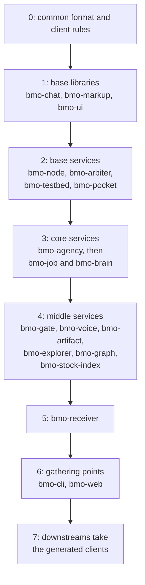

# bmo-next conventions

This document is the one source of two things every bmo-next repository follows: the common wire format a
service answers in, and the rules between an upstream and its downstreams. A service's own documents state its
routes and the pieces they carry, and take the format from here rather than restating it.

## Upstream and downstream

An **upstream** is a repository whose API another calls or imports; that other is its **downstream**. A
repository is often both: the receiver is downstream of the chat protocol and the agency, and upstream of the
chat services that call it.

### Generic and specific

- **Generic**: a capability several downstreams use, or a general one anyone would.
- **Specific**: one downstream's own circumstance, such as its name in a list of callers, or a path or field
  only it uses.

### Rules

- **An upstream stays generic.** Nothing specific goes into it.
- **A specific need is reshaped or kept downstream.** Where a general form of it exists, that form goes into the
  upstream; where none does, the downstream meets it with the API the upstream already serves.
- **An upstream's API is fixed once, before its downstreams are connected to it.** No connection gets an API of
  its own, so the same work is never served differently to different callers.
- **An upstream never knows its callers.** It supplies the mechanism and a safe default; the caller supplies
  the policy. No route, field, branch or list in it names a caller.
- **A change a downstream needs in an upstream is written as the general case.** It carries no name of the
  repository asking, no provider or unit name, no branch for one unit, and no data or test fixture only the
  asker uses; it comes with the upstream's own tests.
- **A downstream keeps no copy of what an upstream serves.** It waits on the upstream for the missing part and
  carries on with the rest, then pins the upstream version that serves it.
- **A downstream document points at the upstream's document** for what the upstream serves, rather than
  restating it.

## The common wire format

Every service answers in this one format, to every caller. A service never answers each caller in that
caller's own format.

| Concern | Convention |
|---|---|
| Keys | Field names in camelCase. |
| Times | One integer of epoch milliseconds. |
| Identifiers | Rooms, messages, senders, items and rows are signed 64-bit integers. |
| Runs | A run's ledger id (a number) and its run name (the unit name, a string) are carried in two fields of different names, both present. |
| Errors and refusals | A non-2xx status with a body of two keys, `code` and `error`. A refusal is answered by status too. |
| Error codes | kebab-case, in step with the camelCase keys. |
| Lists | One cursor, `before` or `after` (an id or a time), and `limit`. |

### Why these

- **camelCase** is what the chat protocol uses, and every service stands on it. Callers move to generated
  clients, so the cost of a change of keys falls once, on the serving side.
- **Milliseconds** keep the order of events within one second, and leave no conversion between seconds and
  milliseconds for a caller to get wrong.
- **One error shape** means a caller reads every failure the same way. A 2xx carrying a flag such as `answered:
  false`, a `problem+json` body, or a `code` with a `text` key are each a second shape, and are not used.

## Service documents

- **Sections by resource.** A service's document groups its routes by the resource they act on, never by the
  caller that uses them. No section is written for one caller.
- **No caller names.** A document names no caller, and a service keeps no list of callers that a new caller
  would have to be added to.

## Clients

- **A service supplies its own client.** It keeps one OpenAPI document in its repository, and from that one
  document it publishes a Rust crate and a TypeScript package.
- **A client carries the service's contract and nothing else.** No caller's policy goes into it.
- **A caller uses the published client.** It writes no client of its own by hand.

## The order upstreams are fixed in

An upstream's API is fixed before the layer below takes it, and each layer takes what the one above fixed in
one step. The common format comes first, since fixing an API before the format would mean changing it again.

- **Layer 1.** bmo-chat defines, as protocol, the routes a provider calls on the receiver, and is the first to
  carry times in milliseconds.
- **Layer 3.** bmo-agency comes before bmo-job and bmo-brain, which call it.
- **Layer 4.** Its services do not overlap and are fixed side by side.
- **Layer 5.** bmo-receiver is upstream of the chat services and downstream of the agency, brain, voice, gate
  and chat, so it is fixed once those are.
- **Layer 6.** bmo-cli and bmo-web gather every unit, so they come last among upstreams. bmo-web attaches every
  bundle through one plugin contract rather than code of its own per bundle.
- **Layer 7.** Each downstream replaces its hand-written clients with the generated ones, moves its copies of
  base code into the base, and meets in itself the specific needs that were kept out of its upstreams.

## A service whose wire differs

- A service's own document states the wire it serves now, and its callers rely on that document.
- Where that wire differs from this document, the service is brought into line when its API is fixed, in the
  order above, and its document is repaired with it.
- The chat protocol in this repository is one such service: its times are Unix seconds.
