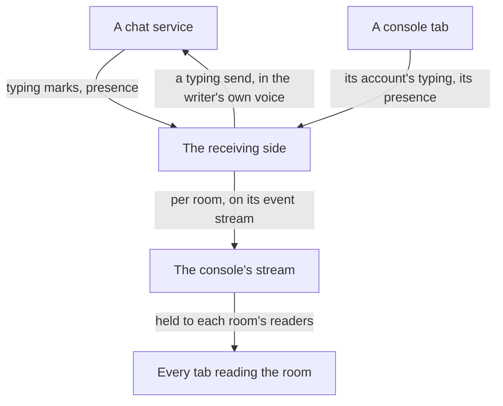

# Presence and typing

Who is writing in a room now, and who is reachable now. Neither is a message: nothing of either is kept in a
room's record, wakes anybody or reaches a turn. They are told while they hold and forgotten once they end.

This is the design every side builds to. The provider's pieces and the two receiving-side routes below are
stated canonically in `contract.md` ("Typing and presence") and `protocol.md`, as the libraries carry them; this
document places them among what the receiving side and the console do with them.

## The two signals

### A typing mark

- **A typing mark is a person writing in a room now:** the room, the person, `on` or off, and `lastsMs`, how
  long the mark stands unless it is told again.
- **A mark ends by itself.** A mark told `on` and not told again ends when its life runs out, so a lost off
  never leaves anybody shown typing. Told `on` again, it stands for a new life from then.
- **It ends at once** when it is told off, when the same person's message reaches the same room, and when the
  provider that told it stops being ready.
- **Its life is the platform's own.** A provider names the life its platform gives a mark (a few seconds on
  every platform that has one); one that names none gets the base's default of six seconds.
- **The life ends a mark's showing, not any work.** Nothing waits on a mark and nothing is stopped by one, so
  it is the indicator's own rule, as a platform's own mark is.

### Presence

- **Presence is whether a person is reachable now,** as `ChatPresence`: `state` and `lastSeenAt`.
- **`ChatPresenceState`:**

| Value | Meaning |
|---|---|
| `online` | the person is at the platform now, busy or not |
| `away` | the person is signed in but idle, or stepped away |
| `offline` | the person is not at the platform, or hides being there |

- **A platform's own states are mapped by its provider:** a busy or do-not-disturb state is `online`, an idle
  or be-right-back state is `away`, an invisible one is `offline`. Nothing outside the provider reads the
  platform's own words.
- **`lastSeenAt`** is the moment the platform says the person was last at it, or null where it does not say.
  A platform's coarse word in place of a moment (recently, within a week) is no moment, and crosses as null.
- **Presence stands until it is told again.** It is never worn out by time. A provider that stops being ready
  leaves the presence it told unknown, not `offline`, until it tells again.
- **Unknown is shown as nothing.** A person whose presence nobody has told, or whose sources all stand
  unknown, is drawn with no presence at all.

## What a chat service tells

- **Two capabilities of `contract.md` say what a provider hears:**

| Capability | Meaning | Words |
|---|---|---|
| `peopleTyping` | the provider tells when a person is writing in a room | tell who is typing in a room |
| `presence` | the provider tells whether a person is reachable | tell who is online |

- **A provider declares each only while the road that hears it runs,** as it declares any capability that
  stands on one road: a provider whose only road that hears typing is a person's account declares
  `peopleTyping` while that account is read. A provider that hears neither declares neither and tells
  nothing, and nothing anywhere keeps a list of which provider hears what.
- **A provider tells only of rooms the receiving side listens to.** In a read-only room it tells only where
  the receiving side asked for the room to be read (`read`), since a person's typing there is as much theirs
  as their words.
- **It tells the presence only of people who stand in such a room,** as a sender of its messages or one of its
  members. A person the account knows only from elsewhere (its contacts, a room nobody listens to) is never
  told of.
- **The account a provider reads by is never told of.** Its typing and its presence are known to the side that
  drives it already.
- **Two receiving-side routes carry them,** and the base's link to the receiving side gains a call for each.
  The link drops a mark or a change whose capability the provider does not declare, without sending it.

| Method | Path | Body | Answer |
|---|---|---|---|
| `POST` | `/typing-marks` | `via`, `roomId`, `personId` (a number of the provider's `people` space), `on` (boolean), `lastsMs` (number or null) | 201, the mark as taken |
| `POST` | `/presence-changes` | `via`; `people`, each `personId`, `state` and `lastSeenAt` (number or null); `whole` (boolean) | 201, the change as taken |

- **A platform that tells a mark again while a person keeps writing** has each one told as it comes: a mark
  told `on` again is its renewal. One that tells no off leaves the mark to end by its life.
- **`whole` is true where the list is every person the provider tells presence of.** A person not listed is
  then unknown. A provider tells a whole list each time it becomes ready, so a receiving side that restarted
  or a provider back from an outage stands on the present at once.
- **A mark or a change about a room the receiving side holds nothing of is passed over** and still answered
  201: neither is anything a provider can repair.
- **bmo-chat-client serves both routes,** and a receiving side that shows neither takes the default, which
  passes both over.

## What a chat service carries out

- **A typing mark goes out as the `typing` send** (`contract.md`, "Sends"), with `on`. Three writers ask for it:
  - **the room's answerer**, while its answer is on its way, in the voice the room is answered by;
  - **the account's owner writing in a console**, in his own voice (`mode` `human-reader`), where it is active;
  - **another account writing in a console**, in that account's own account on the platform (`accountId`,
    `contract.md`, "The account a call is for").
- **A person's typing goes only in their own voice.** A provider that could show it only in its own account,
  or another person's, refuses the send `platform` with its own reason, since a mark in the room's answering
  voice would say the answerer is writing. The sender lets the refusal go and shows the mark nowhere else.
- **The sender renews a mark while it holds,** a send `on` every few seconds, since every platform's mark
  fades by itself; off is sent once. A provider whose platform has no way to take a mark off asks the platform
  nothing for an off and answers it as sent.
- **No presence goes out.** A person's presence on a platform is the platform's own, set by that person's own
  use of it; no provider sets it from anywhere else.

## On the receiving side

- **Nothing is filed.** A mark and a presence change write no row, raise no unread count, move no read mark,
  wake nobody and stand in no turn: whatever composes an answer reads neither.
- **They ride the event stream alone,** as two kinds:
  - `typing`: the room, who (an account, a provider's person by `via` and `personId`, or the room's answerer
    by the speaker the stream names turns under), `on` and `lastsMs`;
  - `presence`: the room, who, `state` (null where unknown) and `lastSeenAt`.
- **Every event names one room.** A person's presence is told once for each room the receiving side holds that
  they stand in, so an event is held to that room's readers by the same scoping that holds the room's messages
  to them, and a room nobody else reads tells nobody else anything.
- **The present is handed to a stream as it opens.** The marks standing and the presence known in a reader's
  rooms come after the replay, as the present picture does, so a screen opened late shows who is writing now.
- **What stands is held in memory alone,** keyed by room and person for a mark and by person for presence;
  a restart loses it, and the whole lists providers tell on becoming ready restore it.
- **A person linked to an account is that account.** Its presence is gathered from every source that tells of
  it, the console and each linked identity on each provider: `online` where any source says so, else `away`
  where any does, else `offline` where any does, else unknown; its `lastSeenAt` is the latest any source
  gives.
- **The answerer is shown writing when the platforms are.** The `typing` events of the room's answerer go on
  and off at the moments the receiving side shows the answerer typing on the room's providers, so every
  surface agrees. A turn that runs before its answer is let through is already on the stream as a turn at
  work, and the console shows that as working, not as writing.
- **A read made unseen tells nothing of its reader.** A reader the receiving side lets read a room that is not
  their own, unseen, is told that room's marks and presence as its readers are, and nothing of their own
  looking or writing reaches the room: no presence there, no mark.

## The console as a messenger of its own

- **An account's presence in the console** comes from the report a console tab makes of the rooms it shows
  and whether it is visible, on opening a room, on being hidden or shown, and every half minute while it is
  open, hidden or not, so a tab left open in the background keeps its account standing. Every signed-in
  account's tabs make it, whatever the account may read:
  - `online` while a tab of the account is open and visible;
  - `away` while its tabs are open and none is visible, for as long as one of them stays open;
  - `offline` once no tab reports, a tab silent for longer than a few of its reports being taken as gone; a tab
    the browser freezes in the background stops reporting, and is taken as gone like a closed one;
  - `lastSeenAt` the last moment a visible tab of it reported.
- **The console tells the receiving side the account's presence as it changes,** one source among the
  account's sources, and the receiving side tells it per room as any presence.
- **An account's typing is the line being written in a room's box:** on as the person types into a box that
  holds words, told again every few seconds while they go on typing, and off when they send, empty the box,
  leave the room or hide the tab. A tab that closes without saying so leaves the mark to end by its life.
- **The console tells the receiving side the mark,** which tells it on the stream to the room's readers and
  hands it as a `typing` send to the room's providers in the writer's own voice, where each can show it.
- **Only a member who may write in the room tells typing.** A reader whose rooms only read stands no box and
  so tells none.
- **A tab of a reader reading a room unseen tells nothing of it:** its report leaves the room out, as it
  already does, and it stands no box to type into there.

## Who sees what

- **A person's presence is seen by those who share a room with them,** in that room, and by the people of
  their own company, wherever the console shows a person of the company (their page, a list of people, a
  picker of members).
- **Never across companies.** A room belongs to one company, so sharing one never crosses a company; a person
  of a platform linked to no account is seen only in the rooms they stand in.
- **A typing mark is seen only in the room it is typed in,** by that room's readers.
- **The console holds these rules where it relays.** It hands a reader the presence of the rooms it reads and
  of its own company's people, and nothing else, as it already holds the stream to a reader's rooms.
- **Each account has one switch, to show its presence,** on unless the account turns it off. Off, nobody sees
  the account's presence or its last moment seen, from the console or from any road its identities stand on,
  every reader with no exception: it is drawn unknown, never as `offline`. The account still sees the presence of
  others.
- **The switch covers presence, not typing.** A mark is told only in a room the person is writing into, to
  people who will read what they send there.
- **What a platform shows its own people is the platform's.** The switch decides what the system tells; a
  person's presence on a platform's own app stands under that platform's own settings.

## What each platform offers

Each provider declares what it can do itself; this is what each platform's roads offer to a provider, for the
provider's own declaration.

| Platform | Typing heard | Typing carried | Presence heard |
|---|---|---|---|
| Telegram | through the owner's account read over MTProto: a person's typing action in a private chat, a group or a channel, renewed by the platform every few seconds and taken off by a cancel action; the bot account hears none | the bot account's chat action for the answerer, a mark of about five seconds the Bot API cannot take off; the owner's account's typing action in his own voice | through the owner's account: a person's status, online with the moment it lapses or offline with the moment last seen, and a coarse recently, last week or last month where the person hides the moment, under each person's own privacy setting; the bot account hears none |
| Discord | the gateway's typing start, for the bot account in the guilds and direct messages its typing intents cover, which are not privileged; a mark of ten seconds with no stop | the channel typing call, a mark of ten seconds with no stop, in the bot account and in the owner's account | the gateway's presence updates of guild members, online, idle, do not disturb or offline, which need the privileged presence intent enabled for the application; no last moment seen |
| Microsoft Teams | none on the bot account, to which Teams delivers no person's typing, and none through Graph, which has no typing state; the client road's push channel to the Teams page is the one road that may carry it | the bot account's typing activity for the answerer; none through Graph; the client road's page for the owner, where it can type as he does | Graph's presence of a chat's members by their user ids, read or subscribed to under the presence read permission on the account it signs in as; availability mapped as above, with no last moment seen; the client road's page may also carry it |
| KakaoTalk | none: the platform shows no typing on any road | none | none: the platform shows no presence |

What stands on Teams' client road is confirmed on that road before the provider declares anything through it;
until then it declares nothing of either there.
